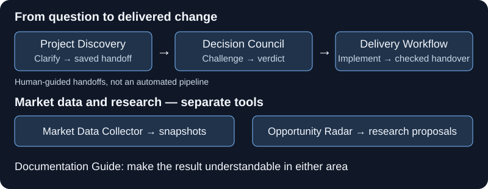

# AI-assisted work you can inspect, verify, and resume

Six practical projects by **Roland Chotika**, developed with AI assistance. Turn an unclear question into a useful handoff, challenge a consequential decision, or deliver a change with evidence you can return to later.



**[Open the visual project guide](https://ollioppa.github.io/Hermes-agent/)** — examples and interactive walkthroughs, directly in your browser.

**Prefer to stay on GitHub? [See a worked before-and-after example](documentation-guide/example.md).** No installation or account needed. It shows the collection's underlying approach: make the inputs, result and checks inspectable—not just the assistant's final answer.

## Pick the problem you have

### “I need to decide what to build—and finish it properly.”

- **[Project Discovery](project-discovery/GUIDE.md):** turn an unclear request into a saved answer or implementation handoff. Unlike an ordinary chat, the result explicitly carries evidence, unresolved questions and the next person's starting point.
- **[Decision Council](decision-council/GUIDE.md):** challenge an important plan through independent perspectives, then read a verdict with supporting findings. For a simple question, a normal chat is enough.
- **[Delivery Workflow](delivery-workflow/GUIDE.md):** carry an authorized change through implementation, actual checks and a saved handover. Return to its recorded state instead of reconstructing progress from chat history.

These can be used separately or as **Discovery → Council → Delivery**. You control the handoffs; this is not an automatically connected pipeline.

### “I need market inputs or a research process I can inspect.”

- **[Market Data Collector](market-data-collector/GUIDE.md):** collect market series, calculate indicators and read structured snapshots. Its offline example produces a synthetic JSON snapshot using the real calculation code.
- **[Opportunity Radar](opportunity-radar/GUIDE.md):** move from an investment idea to a sourced research proposal and an explicitly accepted watchlist or position. Its offline example produces a reader report and demonstrates state changes without sending mail or placing orders.

These are separate projects, not a bundled data feed or trading system.

### “I need someone else to understand the result.”

**[Documentation Guide](documentation-guide/README.md#quickstart)** turns source material into instructions with prerequisites, actions, expected results and recovery. Start with the [worked example](documentation-guide/example.md), then apply the method to your own document.

## Try one thing

**No setup:** open the [Documentation Guide example](documentation-guide/example.md). Compare **Before**, **After** and the preservation check.

**Prefer code?** Follow the [Market Data Collector guide](market-data-collector/GUIDE.md) to install its dependencies and run its credential-free offline example. The output is explicitly synthetic, not current market information.

```sh
git clone https://github.com/ollioppa/Hermes-agent.git
cd Hermes-agent
```

Choose one project; there is no shared installer or Python environment. Agent workflows need the host capabilities listed in their guides. Keep private reports and credentials outside the public checkout, and read the project's safety instructions before live reads or writes.

## Explore the implementation when you need it

Each project includes a self-contained walkthrough with a map, reading paths and the source behind its claims. Open it directly below—no download or account required. You can also download the HTML from the repository for offline use. No project code runs when you open it.

- [Discovery walkthrough](https://ollioppa.github.io/Hermes-agent/project-discovery/walkthrough.html)
- [Council walkthrough](https://ollioppa.github.io/Hermes-agent/decision-council/walkthrough.html)
- [Delivery walkthrough](https://ollioppa.github.io/Hermes-agent/delivery-workflow/walkthrough.html)
- [Collector walkthrough](https://ollioppa.github.io/Hermes-agent/market-data-collector/walkthrough.html)
- [Radar walkthrough](https://ollioppa.github.io/Hermes-agent/opportunity-radar/walkthrough.html)
- [Documentation method walkthrough](https://ollioppa.github.io/Hermes-agent/documentation-guide/walkthrough.html)

The walkthroughs describe a pinned source snapshot, not a recorded live run. Their shared navigation currently uses German labels; the new user guides are English. The manifests beside the HTML retain the source references for technical inspection.

<details>
<summary><strong>Verification, provenance and limits</strong></summary>

### What was verified

- **Market Data Collector:** clean Python 3.14.5 installation on macOS; 255 tests passed; the offline consumer ran twice with identical output; import and network/write isolation checked.
- **Opportunity Radar:** clean Python 3.13 installation; 132 tests passed at export preparation, including a run at the final export location; offline smoke/demo exercised persistence and reader paths. Canonical prompts and selected research references are included.
- **Documentation Guide:** method preservation reviewed; example commands executed; local links and packaged entry files checked.
- **Workflow projects:** local nominal checks saved a Discovery report, completed the Council coordinator using explicitly synthetic role responses, and completed a small text change with Delivery verification. These do not establish live model execution or universal host compatibility.
- **Walkthroughs:** all six passed recorded desktop and mobile browser checks. This establishes tested navigation and layout behavior, not independent reader comprehension.

These are scoped checks, not guarantees of investment performance, live-provider availability or mail delivery. Synthetic examples are not market observations. Historical macro inputs omitted from Market Data Collector must be supplied lawfully for its optional full macro workflow. Project-specific limitations remain in the component documentation.

### About this collection

The repository name is **Hermes-agent**. This is an independent project collection, not the Hermes Agent framework or an official Nous Research distribution.

These are sanitized exports with new Git history. Private operational repositories, their histories, personal databases, credentials, account configuration and internal review logs are excluded. Preparation-stage statements in historical source excerpts describe the original snapshot, not the current publication status.

### License

Each project includes an **MIT LICENSE**. Third-party notices, dependency licenses and market-data rights remain separate; see each component's provenance/rights documents. Code licensing does not grant redistribution rights to provider data.

</details>
